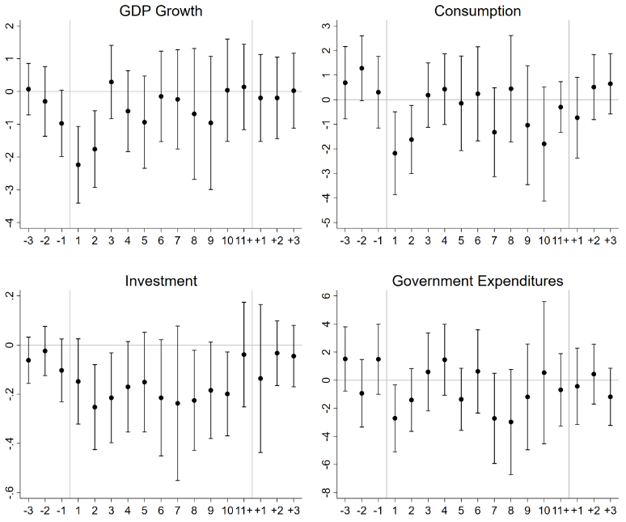

## 今日の目次

1. はじめに
1. 国際関係論における経済と安全保障
1. エコノミック・ステートクラフト
1. 経済安全保障
1. 経済制裁
1. まとめ

# はじめに
::: {.notes}
目標15分
:::
## 先週のRPより
TBD

## 本日の目的と到達目標
#### 目的
経済と安全保障の関係について、国際関係論の歴史的展開を踏まえて理解する。また、エコノミック・ステートクラフト、経済安全保障、経済制裁の事例を通じて、経済的手段による安全保障上の目的の追求と、その可能性・限界について考察する。

::: {.fragment .fade-in}
#### 到達目標
1. 国際関係論において、経済と安全保障の関係がどのように捉えられてきたかを説明できる。
1. エコノミック・ステートクラフトの具体例を挙げ、その効果とリスクを説明できる。
1. 経済安全保障の概念と、輸出管理などの具体的な政策手段を説明できる。
1. 経済制裁の国際法上の位置付けと歴史的展開を説明できる。
:::

## 本日の授業の位置付け

# 国際関係論における経済と安全保障
## 質問
貿易など国境を超えた経済的なつながりは国家の安全に対してどのような影響を与えるでしょうか。

また、安全保障問題が経済に対して与える影響はどのようなものがあるでしょうか。

## 国際関係論の構成
::: {.fragment .fade-in}
#### 安全保障論 (security studies)
国際関係における戦争や平和といった現象を考察
:::

::: {.fragment .fade-in}
#### 国際政治経済学 (international political economu)
国際関係という文脈における、政治と経済の関係を考察

:::

## 1960年代の国際関係論
東西冷戦の一方、国内的には高度成長

::: {.fragment .fade-in}
#### 2トラック論
安全保障問題と経済問題の断絶を強調

:::

::: {.fragment .fade-in}
#### ハイ/ロー・ポリティクス論
経済問題よりも安全保障問題の重要性を強調
:::

## 70年代以降の展開
経済と安全保障の繋がりが意識→IPEの誕生

::: {.incremental}
- **オイルショック**（1973年）…アラブ諸国の石油禁輸→西側諸国の経済混乱
- **日米貿易摩擦**（80年代）…日本の経済的台頭→米国の安保的懸念
- 90年代以降、経済がますます**ハイ・ポリティクス化**
   - 例：ウクライナ戦争、パレスチナ問題、トランプ関税、イラン戦争

:::

## 経済・安全保障関係のパターン
::: {.incremental}
- **エコノミック・ステートクラフト**…軍事/安全保障上の目的のために積極的に経済を利用
  - **経済制裁**…国際社会共通の目的のために経済を利用
- **「経済安全保障」**…他国のESへの対策など経済が安全保障に与える悪影響を緩和

:::

# エコノミック・ステートクラフト
## エコノミック・ステートクラフト
#### economic statecraft
政治的目的を達成するため、軍事的手段ではなく経済的手段を用いて他国に影響を及ぼそうとする試み

::: {.incremental}
- statecraft＝国政術、外交術→「**経済の武器化**」
- 例：輸出入の禁止、資産凍結、資本移動規制
- 広くは**経済制裁**も含むが、国際法上の位置付けを持つものは後述

:::

## ESの実例
::: {.incremental}
- **大陸封鎖令**(1806年）…フランスのナポレオンがイギリスに対して経済関係を途絶
- **対共産圏輸出統制委員会**(COCOM、1949 年)…共産圏に対する「軍事技術」「戦略物資」輸出の規制
- ロシアの**エネルギー外交**（1990s〜）…欧米に靡く旧ソ連構成国に対し資源禁輸

:::

## 質問
エコノミック・ステートクラフト（ES）は経済的な手段を用いて相手国の行動を変えようとする試みでした。

しかし、ESは効果を挙げていると言えるでしょうか？理由も含めて意見を述べてください。

## ESの効果
経済制裁含むESに効果はあるかは研究上でも論争

::: {.incremental}
- 少なくとも経済的な効果はありそう？[^gutmann2023]

:::

::: {.fragment .fade-in}
{width=50%}

:::

[^gutmann2023]: Gutmann, J., Neuenkirch, M., & Neumeier, F. (2023). The economic effects of international sanctions: An event study. *Journal of Comparative Economics, 51*(4), 1214-1231.

## ESのリスク
ただしESには効果を失ったり逆効果になったりするリスクも

::: {.incremental}
- **跳ね返り**…自国も経済的な損失を被る
  - 例：大陸封鎖令とフランス商工業者
- **相手の回避**…相手国も対応するため効果が出にくい
  - 例：オイルショックと国際エネルギー機関
- **相手の反発**…相手国の国内世論を団結させてより強い反発を喚起
  - cf.「旗下結集効果」

:::

# 経済安全保障
::: {.notes}
問いかけ

- 目的：経済安全保障とは何か、内容を予想してみる
- 質問「経済安全保障という言葉を聞いたことはありますか？それはどんな内容だと思いますか」
- 進行：挙手→当てる
:::

## 経済安全保障（economic security）
経済上の措置を講じ国の平和と安全や経済的な繁栄等の国益を確保すること

::: {.incremental}
- 「**攻撃的**」なエコノミック・ステートクラフトに対して「**防御的**」な経済安全保障
- 多義的・曖昧な概念→経済的な動機を隠蔽するレトリック
  - 例：クリントン政権（1993〜2001）…財政赤字や国民皆保険も「経済安保」に位置付け

:::

## 国際輸出管理レジーム
#### Multilateral export control regime
経済安全保障の国際的な枠組みで、通常兵器や大量破壊兵器の不拡散のための取り決めの総体

::: {.fragment .fade-in}
#### ワッセナー協約 (Wassenaar Arrangement)
::: {.incremental}
- 1996年オランダのワッセナーにて合意
- 冷戦期のCOCOMを発展的に改変
- 紛争懸念国に対する物品・技術移転規制
  - 兵器のみならず、軍事目的に使える民生品（センサやコンピュータなど）

:::
:::

## 日本の経済安全保障
::: {.incremental}
- **外国為替及び外国貿易法**（外為法）に基づく規制
  - **リスト規制**…ワッセナー協約に定められた指定物品・技術の規制
  - **キャッチオール規制…**リスト規制を補完するため、特定の国と地域に対する移転を規制
- **経済安全保障推進法**（2022年）…内閣府経済安全保障推進室と特命担当大臣の設置
  - 重要物資の供給確保、基幹インフラ役務の提供確保、先端技術の開発支援、特許の非公開

:::

# 経済制裁
## 経済制裁（economic sanction）
国際社会がその総意に基づいて、経済を手段として特定国に特定の行動を取らせるよう強制する措置

::: {.incremental}
- 名目上、国際社会の共通の利益（平和・人権）を追求→国際法上の位置付けが明確
  - **国連憲章**第7章（平和に対する脅威、平和の破壊及び侵略行為対する措置）の第41条
    - 「経済関係及び鉄道、航海、航空、郵便、電信、無線通信その他の運輸通信の手段の全部又は一部の中断並びに外交関係の断絶」
- ただし制裁名目で実質的にESが行われることがある

:::

## 経済制裁の傾向
冷戦終結後に一気に活発化

::: {.incremental}
- 南アフリカおよび南ローデシアのアパルトヘイト
- イラクのクウェート侵攻
- 印パ・セルビア・イランの核開発
- セルビア民族浄化

:::

::: {.fragment .fade-in}
Q. なぜ90年代以降に経済制裁が盛んになった？
:::

# まとめ
## 本日の目的と到達目標
#### 目的
経済と安全保障の関係について、国際関係論の歴史的展開を踏まえて理解する。また、エコノミック・ステートクラフト、経済安全保障、経済制裁の事例を通じて、経済的手段による安全保障上の目的の追求と、その可能性・限界について考察する。

::: {.fragment .fade-in}
#### 到達目標
1. 国際関係論において、経済と安全保障の関係がどのように捉えられてきたかを説明できる。
1. エコノミック・ステートクラフトの具体例を挙げ、その効果とリスクを説明できる。
1. 経済安全保障の概念と、輸出管理などの具体的な政策手段を説明できる。
1. 経済制裁の国際法上の位置付けと歴史的展開を説明できる。
:::

## 次回までに
#### 事後学習

 - 授業資料を見直し、目標到達をセルフチェック
 - Moodle上でのリアクションペーパー入力（木曜日まで）
