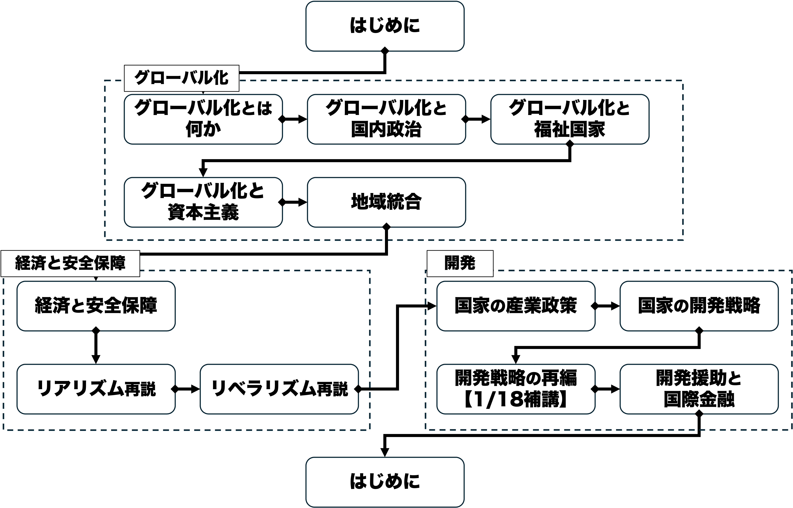

## 今日の目次

1. はじめに
1. リアリズム
1. 相対的利益論
1. マスタンドゥーノの事例研究
1. セキュリティ外部性論
1. まとめ

# はじめに
::: {.notes}
目標15分
:::
## 先週のRPより
TBD

## 本日の目的と到達目標
#### 目的
リアリズムに位置付けられる議論を学ぶ。リアリズムの概要を学習／復習したのちに、相対的利益論の見地から国家間協力がなぜ難しいのか議論する。また、セキュリティ外部性論を学び、国境を超えた経済活動が安全保障に与える影響を検討する。

::: {.fragment .fade-in}
#### 到達目標
1. リアリズムの議論の仮定を5つ挙げることができる。
1. グリエコの定式化に触れつつ、相対的利益論の内容を説明できる。
1. マスタンドゥーノの事例研究を踏まえて、相対的利益が国家の行動にどのような影響を与えるのかを説明できる。
1. セキュリティ外部性論の議論の概要を説明できる。
:::

## 本日の授業の位置付け

# リアリズム
## リアリズム
アナーキーな国際政治の中で国益と力を追求する国家同士の競争的関係を強調する考え

::: {.fragment .fade-in}
#### 重商主義（mercantilism）
貿易黒字を最大化するために国家主導による国内産業育成と輸入の規制を求める経済政策上の考え方

:::

::: {.fragment .fade-in}
#### 覇権安定理論（Hegemonic Stability Theory: HST）
他国を圧倒する国力を持った覇権国（hegemon）が存在すると国際関係が安定

:::

## リアリズムの5つの仮定
::: {.incremental}
1. 国際政治では国家が主体
1. 国内は一枚岩
1. 国家は国益（特に安全保障）と力を追求する
1. 国家間の力関係は主に軍事力が中心
1. 国家は打算的

:::

## 質問
リアリズムの5つの仮定は現実的でしょうか。

もし当てはまらないとすれば、それはなぜですか。

現実の事例も踏まえながら考えてみましょう。

# 相対的利益論
## 質問
今後10年の日本と中国のGDPについて、以下2つのような仮想のシナリオがあります。

1. 日本は10%、中国は20%それぞれ成長する。
2. 日本は5%、中国は6%それぞれ成長する。

日本の立場としてはどちらが望ましいですか。それはなぜですか。

## 相対的利益論
国家は主に相対的な利益の最大化を目指して行動するとの立場

::: {.fragment .fade-in}
#### グリエコの定式化[^grieco1988]
国家は以下で表される効用$U$の最大化をするべく行動

$$
U = V - k(W-V)
$$

::: {.incremental}
- $V$：自国の絶対的利益
- $W$：他国の絶対的利益
- $k$：自国の相対的利得に対する敏感性
   - $k=0$ならば絶対的利益だけを気にする
   - 通常は$k>0$なので相対的利益も気にする

:::
:::

[^grieco1988]: Grieco, J. M. (1988). Anarchy and the limits of cooperation: a realist critique of the newest liberal institutionalism. *International Organization, 42*(3), 485-507.
   
::: {.notes}
相対的利益論

- 国家は大きなWinWinよりも相手に対して大きな差をつけることを優先
- したがって、国際協調は難しい

:::

## 敏感性の要因
::: {.incremental}
- **両国間関係**…友好的か敵対的か
   - 例：アメリカ相手と中国相手
- **国家の関心**…経済か安全保障か
   - 例：ヨーロッパとイスラエル
- **国力の現状**…成長中か衰退中か
   - 例：日米と中国
   
:::

# マスタンドゥーノの事例研究
## 質問
](https://www.mod.go.jp/asdf/img/equipment/F-2/high/photo01.jpg){.r-stretch}

::: {.notes}
質問

- 目的：相対的利益が実際の政策決定に与えた影響を理解する
- 質問「（F-2の写真を見せながら）日本は1980年代、自衛隊の次期戦闘機について、当初はエンジンのみを米国から輸入し、機体は国内で開発することを考えていました。しかし、米国はこれに反対し、最終的には米国との共同開発となりました。その際、米国から日本への技術移転にも制約が設けられました。米国はなぜ、このような対応を取ったのでしょうか。」
- 進行：当てる
:::

## マスタンドゥーノの事例研究[^mastanduno1991]
80年代の時期支援戦闘機（FSX）開発計画を相対的利益論から分析

::: {.incremental}
- 主張：アメリカが相対的利益を追求した結果、FSX共同開発に制約
  - FSX開発計画は本来は安全保障上両国に利益
  - しかし横槍が入り開発が遅延し完成したF-2は高額化

:::

[^mastanduno1991]: Mastanduno, M. (1991). Do Relative Gains Matter America’s Response to Japanese Industrial Policy. *International Security, 16*(1), 73-113.

## 背景
{.r-stretch}

::: {.notes}
自衛隊初の国産戦闘機F-1

- 戦前まで日本の航空産業は盛ん
- 敗戦後GHQの命令により飛行機製造禁止→航空産業の壊滅
- F-1は初の国産戦闘機として、航空産業復活の要
- しかし老朽化も進み80年代に新型機導入が議論され始める

:::

## 日本の当初方針とアメリカの横槍
::: {.incremental}
- 日本は当初F-1と同様の国産開発案
   - 自力開発困難なエンジンだけは輸入
   - エンジン以外の機体等は全て自力開発
- アメリカはエンジンだけの輸出に消極的
    - 当時は貿易摩擦→対日赤字が積み上がる
    - 特に商務省・通商代表部・議会・航空業界→日本の経済的伸長に脅威認識

:::

## 共同開発合意と見直し
::: {.incremental}
- **FSX開発計画**（1982年）…米が開発・製造技術を提供する形の共同開発で合意
  - 安全保障上日米協力を進めたい国務省・国防総省は肯定的
  - 他方商務省らは反対→「技術提供は安全保障上問題」
- 1989年2月合意見直し
  - ブッシュ（父）大統領が国防・商務両省に作業を指示
  - 米国企業は日本の技術にアクセス可能
  - 米国の技術の日本への譲渡は規制

:::

# セキュリティ外部性論
## 質問
次の国々のうちどの国・地域と日本は貿易すべき／しないべきだと思いますか。理由も一緒に考えてみましょう。

- アメリカ
- 中国
- イギリス
- 台湾
- 韓国
- ロシア

## セキュリティ外部性
#### security externalities
ある国の経済的な意思決定がその安全保障環境に影響を与えること

::: {.incremental}
- 貿易の開始→相手国の経済発展→相手国の国力伸長
- 友好国なら嬉しいが敵対国なら嬉しくない
:::

::: {.fragment .fade-in}
→自由貿易は必ずしも歓迎されるわけではない

::: {.incremental}
- Cf. 商業的平和論

:::
:::

## 事例
::: {.incremental}
- 戦間期**ブロック経済**
   - ブロック外の製品の排除
- **GATT=ブレトン・ウッズ体制**
    - 西側諸国のみで旧ソ連圏は排除
    - COCOM による対ソ連圏貿易の厳重規制
- **ウクライナ戦争**
   - 西側とロシアは相互に貿易規制

:::

## 同盟関係と貿易
](figs/alliance_trade.png)

::: {.notes}
二極化時代（1955年以降）において、同盟関係が貿易を増やす
:::

# まとめ
## 本日の目的と到達目標
#### 目的
リアリズムに位置付けられる議論を学ぶ。リアリズムの概要を学習／復習したのちに、相対的利益論の見地から国家間協力がなぜ難しいのか議論する。また、セキュリティ外部性論を学び、国境を超えた経済活動が安全保障に与える影響を検討する。

::: {.fragment .fade-in}
#### 到達目標
1. リアリズムの議論の仮定を5つ挙げることができる。
1. グリエコの定式化に触れつつ、相対的利益論の内容を説明できる。
1. マスタンドゥーノの事例研究を踏まえて、相対的利益が国家の行動にどのような影響を与えるのかを説明できる。
1. セキュリティ外部性論の議論の概要を説明できる。
:::

## 次回までに
#### 事後学習

 - 授業資料を見直し、目標到達をセルフチェック
 - Moodle上でのリアクションペーパー入力（木曜日まで）